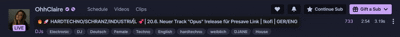

# Twitch Title Shortener Userscript

This lightweight userscript automatically shortens long Twitch stream titles to prevent layout issues and displays the full text on hover.

## Key Features

* **Concise Titles**: Titles are truncated to a maximum width (400px by default) with an ellipsis.
* **Hover Preview**: Hover over a title to view the full text in a Twitch-styled box that matches dark and light theme.
* **High Performance**: Pure CSS implementation ensures zero impact on browsing speed.



## Installation

A userscript manager such as Tampermonkey, Violentmonkey, or ScriptCat is required.

1. Open [twitch-title-shortener.user.js (Raw)](https://raw.githubusercontent.com/OD728/STwitchT/main/twitch-title-shortener.user.js).
2. Your userscript manager offers to install it. Click **Install**.

The script then updates itself automatically when a new version is published here.

If the manager doesn't open an install page, create a new script in it instead, paste the code from the link above, and save (Ctrl+S).

### Chrome and Edge

Chromium-based browsers need an extra permission for userscript managers (Manifest V3):

1. Use the latest version of your userscript manager.
2. Open the browser's extension page (`chrome://extensions` or `edge://extensions`), click **Details** on your userscript manager, and turn on **Allow User Scripts**.
3. On older browser versions (before Chrome 138) that option doesn't exist. Turn on **Developer Mode** on the extensions page instead.

## Customization

Adjust truncation width and hover styling by editing the CSS within the script:

```css
[data-a-target="stream-title"] {
  max-width: 400px !important; /* Default truncation width */
}

[data-a-target="stream-title"]:hover {
  background: var(--color-background-base, #18181b) !important; /* Twitch's theme color */
  z-index: 9999 !important;
}
```

Note: if you edit the installed script, an automatic update will replace your changes. Turn off update checks for the script in your userscript manager to keep them.

## License

[MIT](LICENSE)
